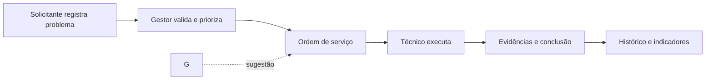
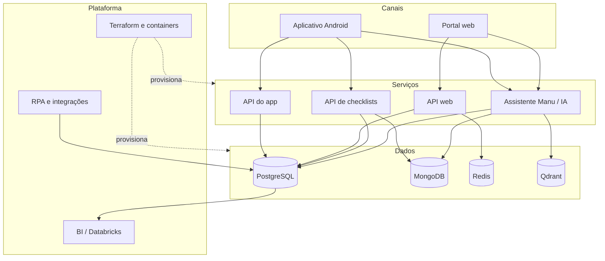

  

  <a href="#o-fixa">O FIXA</a> ·
  <a href="#como-funciona">Como funciona</a> ·
  <a href="#para-cada-perfil">Perfis</a> ·
  <a href="#ecossistema">Ecossistema</a> ·
  <a href="#arquitetura">Arquitetura</a> ·
  <a href="#tecnologias">Tecnologias</a> ·
  <a href="#desenvolvimento">Desenvolvimento</a>

  <strong>Gestão consciente para manutenção inteligente.</strong> 
  Solicitações, ordens de serviço, equipamentos, checklists e indicadores em uma experiência integrada.

  
  

## O FIXA

Nas escolas, uma lâmpada queimada, um ar-condicionado parado ou uma porta com defeito podem afetar aulas, equipes e toda a rotina da comunidade. Quando as solicitações ficam dispersas em conversas e planilhas, a prioridade se perde, o histórico desaparece e a gestão trabalha sem uma visão confiável da operação.

O **FIXA** centraliza esse processo. A plataforma conecta solicitantes, técnicos e gestores para registrar problemas, transformar demandas validadas em ordens de serviço, acompanhar a execução e preservar evidências e histórico. O resultado é uma manutenção mais clara, rastreável e orientada por dados.

> O projeto é interdisciplinar e está em desenvolvimento. Os recursos descritos combinam funcionalidades já representadas no código com o escopo funcional planejado para a plataforma.

## Como funciona

| Etapa | O que acontece |
| --- | --- |
| **1. Solicitar** | O usuário descreve o problema, informa o local e pode anexar imagens. |
| **2. Validar e priorizar** | O gestor revisa a demanda. |
| **3. Planejar** | A solicitação validada entra no fluxo de trabalho, recebe responsável e pode ser agendada no calendário. |
| **4. Executar** | O técnico acompanha a ordem de serviço no Kanban, atualiza o status e registra ocorrências ou imprevistos. |
| **5. Concluir** | A solução aplicada e pelo menos uma evidência fotográfica ficam registradas para consulta e indicadores. |

## Para cada perfil

<table>
  <tr>
    <td width="33%" valign="top">
      <h3>Solicitante</h3>
      <ul>
        <li>Abre e acompanha solicitações.</li>
        <li>Consulta o status das ordens de serviço.</li>
        <li>Cancela solicitações ainda sem técnico.</li>
        <li>Recebe atualizações dos eventos de manutenção.</li>
        <li>Interage com a assistente <strong>Manu</strong>.</li>
      </ul>
    </td>
    <td width="33%" valign="top">
      <h3>Técnico</h3>
      <ul>
        <li>Organiza tarefas em um quadro Kanban.</li>
        <li>Filtra demandas por data, categoria e prioridade.</li>
        <li>Consulta ordens, ocorrências e histórico.</li>
        <li>Registra solução, dificuldade, imprevistos e fotos.</li>
        <li>Preenche PMOC e outros checklists.</li>
      </ul>
    </td>
    <td width="33%" valign="top">
      <h3>Gestor</h3>
      <ul>
        <li>Valida demandas e distribui o trabalho.</li>
        <li>Gerencia técnicos, competências e equipamentos.</li>
        <li>Configura modelos de checklist.</li>
        <li>Planeja serviços no calendário.</li>
        <li>Acompanha indicadores e exporta relatórios.</li>
      </ul>
    </td>
  </tr>
</table>

## Capacidades da plataforma

<strong>Gestão de solicitações e ordens de serviço</strong>

 

- Kanban com visões de todas as tarefas, a fazer, em andamento, atrasadas e concluídas.
- Cards com título, descrição, categoria, solicitante, responsável, prioridade, data e até duas imagens.
- Validação obrigatória pelo gestor antes da execução.
- Encerramento com descrição do serviço e evidência fotográfica.
- Histórico das tarefas concluídas para rastreabilidade.

<strong>Equipamentos, PMOC e checklists</strong>

 

- Cadastro de equipamentos, categorias, marcas e modelos.
- Modelos flexíveis de checklist e registros de inspeção.
- Ciclo de disponibilidade entre pendente de preenchimento e checklist concluído.
- Escopo inicial voltado a aparelhos de ar-condicionado, preparado para outros ativos.
- Exportação de checklists para auditoria e conformidade.

<strong>Inteligência artificial e assistente Manu</strong>

 

- Arquitetura multiagente com especialistas por perfil, supervisor e camada de avaliação.
- Apoio à categorização, à priorização e à distribuição inteligente de demandas.
- Conversas persistidas com proteção de dados pessoais e memória vetorial.
- Consultas a contexto operacional e documentos por meio de LangGraph, MongoDB e Qdrant.

<strong>Planejamento, indicadores e integração de dados</strong>

 

- Calendário de atividades, eventos, horários e localidades.
- Dashboard individual para técnicos e visão consolidada para gestores.
- Relatórios mensais e exportação para planilhas.
- Estrutura analítica com dimensões e fatos de problemas, ocorrências e ordens de serviço.
- Frentes de RPA, BI e carga vetorial para integrar e preparar dados.

## Ecossistema

Os componentes são mantidos em repositórios separados para permitir evolução independente. O mapa abaixo representa o estado público da organização em outubro de 2026.

| Componente | Responsabilidade | Estado observado |
| --- | --- | --- |
| [`segundo-app-fixa`](https://github.com/Fixa-Inter/segundo-app-fixa) | Aplicativo Android com autenticação, abertura e acompanhamento de solicitações, agenda, notificações, perfil e chatbot. | Em desenvolvimento |
| [`segundo-aplicacao-website`](https://github.com/Fixa-Inter/segundo-aplicacao-website) | Portal web da gestão de manutenção. | Estrutura inicial |
| [`segundo-api-app`](https://github.com/Fixa-Inter/segundo-api-app) | API do aplicativo: problemas, ocorrências, ordens, tarefas, técnicos, equipamentos e eventos. | Em desenvolvimento |
| [`segundo-api-web`](https://github.com/Fixa-Inter/segundo-api-web) | API do portal web: autenticação, usuários, perfis, aptidões, turnos, instituições, locais e eventos. | Em desenvolvimento |
| [`segundo-api-nosql`](https://github.com/Fixa-Inter/segundo-api-nosql) | Serviço de modelos e inspeções de checklist com persistência MongoDB e integração SQL. | Em desenvolvimento |
| [`segundo-inteligencia-artificial`](https://github.com/Fixa-Inter/segundo-inteligencia-artificial) | Assistente multiagente, guardrails, memória, observabilidade e integrações de IA. | Em desenvolvimento |
| [`segundo-modelagem-dados-fixa`](https://github.com/Fixa-Inter/segundo-modelagem-dados-fixa) | Modelo PostgreSQL, procedures, triggers, auditoria, seeds e views analíticas. | Em desenvolvimento |
| [`segundo-popular-qdrant`](https://github.com/Fixa-Inter/segundo-popular-qdrant) | Carga e indexação de conteúdo no banco vetorial Qdrant. | Em desenvolvimento |
| [`segundo-business-intelligence`](https://github.com/Fixa-Inter/segundo-business-intelligence) | Preparação de dados no Databricks para análises e indicadores. | Estrutura inicial |
| [`segundo-rpa`](https://github.com/Fixa-Inter/segundo-rpa) | Integração do banco legado com o modelo normalizado. | Estrutura inicial |
| [`segundo-infraestrutura`](https://github.com/Fixa-Inter/segundo-infraestrutura) | Infraestrutura como código com Terraform. | Estrutura inicial |
| [`.github`](https://github.com/Fixa-Inter/.github) | Perfil, padrões de engenharia, templates e automações compartilhadas. | Ativo |

## Arquitetura

## Tecnologias

| Área | Tecnologias identificadas |
| --- | --- |
| **Mobile** | Android, Java, AndroidX e Material Design |
| **Back-end** | Java 21, Spring Boot, Spring Security, JPA, Bean Validation e OpenAPI |
| **Inteligência artificial** | Python, FastAPI, LangChain, LangGraph, Gemini, Groq e OpenAI |
| **Dados** | PostgreSQL, MongoDB, Redis e Qdrant |
| **Qualidade e observabilidade** | Pytest, Spring Test, Actuator e Prometheus |
| **Infraestrutura** | Docker, Terraform e GitHub Actions |
| **Gestão e colaboração** | GitHub Projects, Issues, Pull Requests e Conventional Commits |

## Desenvolvimento

Cada componente tem dependências e comandos próprios. Antes de executar um serviço, consulte o README e os arquivos de configuração do respectivo repositório.

O [guia de engenharia](https://github.com/Fixa-Inter/.github/blob/main/README.md) reúne o fluxo oficial da equipe, incluindo padrões de branches, commits, Pull Requests, code review, Kanban, releases e templates.

### Fluxo de contribuição

1. Escolha ou abra uma Issue no repositório correspondente.
2. Crie uma branch seguindo o padrão definido pelo time.
3. Implemente a alteração e valide o componente localmente.
4. Registre commits claros e rastreáveis.
5. Abra um Pull Request usando o template oficial.
6. Aguarde code review e homologação antes do merge.

## Roadmap funcional

- Consolidar o portal web de gestão.
- Integrar os canais mobile e web às APIs.
- Completar o fluxo de validação, distribuição e encerramento de ordens.
- Evoluir PMOC, checklists e exportações de auditoria.
- Disponibilizar dashboards e relatórios mensais.
- Ampliar a assistente Manu e as recomendações inteligentes.
- Expandir o catálogo de equipamentos além de aparelhos de ar-condicionado.

## Contato e licença

Para conhecer o projeto, acompanhar os repositórios ou entrar em contato com a equipe:

- Organização: [github.com/Fixa-Inter](https://github.com/Fixa-Inter)
- E-mail: [fixai.inter2026@gmail.com](mailto:fixai.inter2026@gmail.com)

Os repositórios podem adotar licenças próprias. Consulte o arquivo `LICENSE` de cada componente antes de reutilizar o código; diversos repositórios públicos da organização usam a licença MIT.

  <strong>FIXA</strong> · Gestão consciente para manutenção inteligente.

